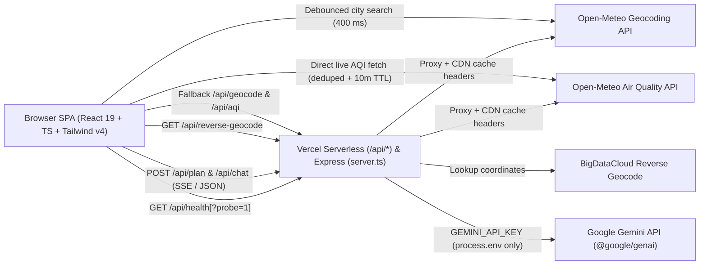

# Architecture — SafeAir Saathi

SafeAir Saathi pairs client-side telemetry from Open-Meteo with server-isolated Google Gemini generation so winter smog guidance works fast, stays scientifically grounded, and never exposes API keys to the browser.

## System Data Flow

## Folder Responsibilities

| Folder / File | Responsibility |
| --- | --- |
| `api/` | Thin Vercel serverless adapters forwarding requests to `src/server/` handlers (`plan.ts`, `chat.ts`, `geocode.ts`, `reverse-geocode.ts`, `aqi.ts`, `health.ts`). |
| `src/server/` | Shared Node HTTP/SSE runtime: `env.ts` (Zod env config), `httpBody.ts` / `httpUtils.ts` (32 KB caps, media-type checks, security headers), `schemas.ts` (Zod schemas), `rateLimitStore.ts`, `openMeteoProxy.ts`, `geminiClient.ts`, `geminiStream.ts`, `geminiSseEmitter.ts`, `geminiRunner.ts`, `routeHelpers.ts`, `healthHandler.ts`, `geoAqiHandlers.ts`, `aiRouteHandlers.ts`, `apiHandlers.ts`. |
| `src/components/` | Pure presentational and section components (`Header`, `Footer`, `AqiHeroCard`, `CleanAirThoughtCard`, `ProfileForm`, `ActionPlanView`, `ImpactCalculator`, `FollowUpChat`, `SafeMarkdown`, `ErrorBoundary`), decomposed subcomponents (`aqi/`, `plan/`, `form/`, `chat/`), and inline SVG illustrations (`illustrations/`). |
| `src/hooks/` | State/lifecycle orchestration: `useAirQuality`, `useCitySearch`, `useGeolocation`, `usePlanGenerator`, `useProfileForm`, `useFollowUpChat`, `useThemeAndMotion`, `useSpeechSynthesis`, `useDebounce`. |
| `src/services/` | Browser fetch clients (`airQuality.ts`, `geocoding.ts`, `gemini.ts`, `geminiPlanService.ts`, `geminiStream.ts`, `geminiPayloads.ts`) with in-flight deduplication and TTL caching. |
| `src/utils/` | Pure domain helpers: AQI math (`aqi.ts`), weekly swap math (`impactCalculator.ts`), prompt construction (`promptBuilder.ts`), safe AST markdown (`safeMarkdown.ts`, `safeMarkdownInline.ts`), scientific claim sanitization (`scientificFilter.ts`), Zod schemas (`validation.ts`), error taxonomy (`errorDiagnostics.ts`), deterministic fallback (`fallbackPlan.ts`), TTL cache (`cache.ts`), sliding rate limiter (`rateLimiter.ts`), network timeouts (`network.ts`), preference storage (`storage.ts`). |
| `src/constants/` | Named application constants (`limits.ts`), US AQI breakpoints (`aqiCategories.ts`), calculator swaps (`impactChoices.ts`), fallback templates (`fallbackTemplates.ts`), re-exported via `index.ts`. |
| `src/i18n/` | Typed EN (`en.ts`) and HI (`hi.ts`) dictionaries sharing `TranslationDictionary` (`types.ts`) with 100% key parity verified by tests. |
| `tests/` | Unit, service, server handler, end-to-end integration, and `jest-axe` accessibility suites (`vitest`). |
| `server.ts` | Local Express + Vite dev server (`tsx server.ts`) and standalone Node production server (`dist-server/server.js --prod`). |

## Request Lifecycles

### `POST /api/plan`

1. **Method, Rate Limit & Body Parsing:** Enforces `POST` / `OPTIONS`, sliding per-IP rate limit (`20/min`), `application/json` content type (`415`), and `<= 32 KB` body limit (`413`).
2. **Validation:** `planRequestSchema` validates location coordinates, US AQI (`0–500`), lifestyle profile enums, and free-text bounds (`<= 500` chars).
3. **Model Fallback & Streaming:** `geminiRunner.ts` attempts SSE streaming first across the ordered fallback chain (`GEMINI_MODEL` if set -> `gemini-3.5-flash-lite` -> `gemini-3.8-flash` -> `gemini-3.6-flash`) with a `45s` budget inside Vercel's `60s` limit.
4. **Scientific Guard & JSON Repair:** On completion, `tryParseValidPlanJson` validates against `actionPlanSchema` and runs `sanitizePlanScientificClaims` (emitting `replacementText` if claims were corrected). If SSE streaming fails non-fatally or produces malformed JSON, `/api/plan` executes non-streaming JSON generation (or 1 bounded repair pass) and surfaces the safe rule-based fallback plan if AI remains unreachable.

### `POST /api/chat`

1. **Validation & Context Bounding:** `chatRequestSchema` caps questions (`<= 500` chars), bounded conversation history, and active city/AQI context.
2. **Streaming & Claim Buffering:** `createChatChunkEmitter` buffers short segments when suspected unscientific claims appear (`houseplant PM2.5`, `100% filtration`, `cloth mask`), sanitizes completed sentences on the fly, and emits SSE `chunk` and `done` frames with `truncated` / `finishReason` metadata so the UI shows a bilingual **Continue** button on `MAX_TOKENS`.
3. **XSS Defense:** Client `SafeMarkdown` parses only paragraphs, lists, bold, italic, and line breaks into React elements without `dangerouslySetInnerHTML`.

## Key Design Decisions

- **Server-Side API Key Isolation:** `GEMINI_API_KEY` is read exclusively through `src/server/env.ts` on the server; client bundles use no `VITE_` secret variables.
- **Ordered Model Fallback:** Trying `gemini-3.5-flash-lite` first minimizes tail latency and cost while falling back automatically to `gemini-3.8-flash` and `gemini-3.6-flash` on transient `404`/`429`/`503` errors.
- **Structured JSON + Deterministic Fallback:** Plan outputs follow an explicit Gemini `responseSchema` paired with Zod validation and `buildRuleBasedFallbackPlan` so guidance stays reliable offline or when keys are unconfigured.
- **Privacy by Default:** Zero cookies, zero background GPS polling, and zero persistent location storage (`localStorage` stores only language and motion-pause preferences).
