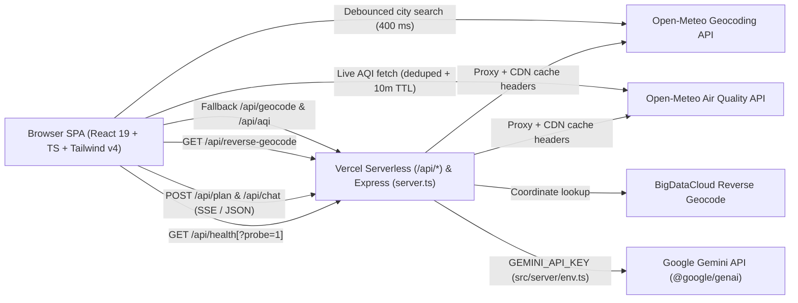

# SafeAir Saathi

**Bilingual (English / हिंदी) GenAI assistant helping families and communities navigate severe winter smog and urban air pollution with live AQI insights, tailored action plans, and transparent impact estimates.**

### **[Live Demo: https://safe-air-lilac.vercel.app/](https://safe-air-lilac.vercel.app/)**

[](https://safe-air-lilac.vercel.app/)
[](https://github.com/safeair-saathi/safeair-saathi/actions/workflows/ci.yml)
[](https://react.dev/)
[](https://www.typescriptlang.org/)
[](https://vite.dev/)
[](https://vercel.com/)
[-15803d?style=flat-square>)](#testing)
[](./LICENSE)

> **Medical Disclaimer:** All guidance in SafeAir Saathi is for informational and educational purposes only and is **not medical advice**. Always consult a qualified healthcare professional for respiratory symptoms, asthma flare-ups, pregnancy care, or medical emergencies.

---

## Chosen Vertical & Problem Statement

- **Chosen Vertical:** **Urban Air Quality, Climate, and Public Health** (**PromptWars Challenge 6**).

> _"Create a GenAI-powered assistant that helps families and communities navigate severe winter smog and urban air pollution. It should suggest low-emission daily routines, indoor air quality hacks, and sustainable alternatives tailored to their location and lifestyle, while clearly explaining the direct impact of their choices."_

## Approach & Logic

SafeAir Saathi combines real-time local environmental telemetry with household-aware AI synthesis and deterministic fallbacks so families receive actionable, scientifically accurate winter smog protection even under flaky network or quota conditions:

1. **Live Telemetry + Resilient Manual Fallback:** Direct browser Open-Meteo queries (`10 min` TTL cache, in-flight deduplication, and `400 ms` search debouncing) pair with `/api/aqi`, `/api/geocode`, and `/api/reverse-geocode` server fallbacks plus an explicit `0–500` manual US AQI override.
2. **Household-Tailored GenAI Orchestration:** The server validates lifestyle inputs via Zod (`src/server/schemas.ts`), isolates untrusted text inside `<<<USER_DATA_START>>>` / `<<<USER_DATA_END>>>` delimiters, and streams structured four-section JSON plans via `@google/genai` (default `gemini-3.5-flash-lite` with optional `GEMINI_MODEL` override and ordered fallback `gemini-3.5-flash-lite` → `gemini-3.8-flash` → `gemini-3.6-flash`), seamlessly degrading to non-streaming JSON, 1 bounded JSON repair pass, or an offline bilingual rule-based plan (`src/utils/fallbackPlan.ts`).
3. **Scientific Accuracy & Impact Math:** Every AI card and chat answer passes through `src/utils/scientificFilter.ts` to reject debunked claims (such as houseplants removing winter PM2.5 or cloth masks blocking PM2.5), while the interactive Impact Calculator combines weekly swap reductions multiplicatively with `×0.85` diminishing returns and a `65%` cap (`src/utils/impactCalculator.ts`).
4. **Bilingual & Accessible First:** 100%-key-matched English and Hindi dictionaries (`src/i18n/`), zero-HTML `SafeMarkdown`, light/dark modes, SVG animations synced to `prefers-reduced-motion` and a persistent **Pause animations** toggle, and WCAG 2.2 AA semantics ensure universal usability.

---

## Features

- **Location and Live AQI**
  - Debounced city search (`400 ms`) via Open-Meteo Geocoding API with automatic `/api/geocode` server cache fallback.
  - Explicit click-triggered browser geolocation (`Use My Location`) with zero background tracking; resolves coordinates to human-readable locality/city names via `/api/reverse-geocode` (with graceful coordinate fallback).
  - Displays US AQI (`0–500`), an animated `0→value` semi-circular SVG gauge, an AQI-reactive skyline illustration (`HeroSkylineIllustration` across `clear`, `hazy`, and `dense` tiers), a clean-air rotating thought card (`CleanAirThoughtCard`, 8 EN/HI original thoughts pausing on hover, focus, or explicit Pause button), color + icon + text category (`Good` through `Hazardous`), plus `PM2.5`, `PM10`, `NO₂`, and `O₃` (`µg/m³`), data source, and localized timestamp.
- **Personalization**
  - Captures household risk groups (`children`, `elderly`, `asthma/respiratory`, `pregnant`), commute mode (`walk`, `bike`, `bus`, `metro`, `two-wheeler`, `car`), work style (`WFH`, `office`, `outdoor`), home type (`apartment`, `house`), air purifier ownership, cooking fuel (`LPG`, `induction`, `wood`, `other`), budget tier (`low`, `medium`, `high`), and sanitized optional notes (`<= 500` chars).
- **AI Plan (4 Sections & Freshness Tracking)**
  - **Low-Emission Daily Routine:** Morning, commute, afternoon, and evening actions with recommended **best** and **worst** outdoor time windows.
  - **Indoor Air Quality Hacks:** Ventilation timing, draft sealing, wet mopping, HEPA/DIY MERV-13 box-fan filtration, clean cooking tips, and runtime-enforced scientific accuracy (explicitly rejecting claims that houseplants remove winter PM2.5 or `100%` smog removal).
  - **Sustainable Alternatives:** Transport, cooking, heating, and open waste-burning avoidance matched to budget tier.
  - **Health Protection:** Well-fitted N95/FFP2 mask guidance, early respiratory symptoms to watch, and clear red-flag signs for seeing a doctor, paired with an AQI-colored `BreathingLungsIllustration`.
  - **Freshness & Focus Management:** Automatically displays a **Why this plan fits you** context card, detects when location, AQI, or language changes (hiding stale AQI guidance behind a polite `role="status"` **Regenerate for this location** banner), and moves keyboard/screen-reader focus onto the generated plan upon completion.
- **Impact Explanation and Calculator**
  - Every AI and fallback recommendation pairs a plain-language **Why this helps** explanation with a deduplicated **Estimated impact (approximate)** line (`cleanImpactText`).
  - Interactive weekly **Impact Calculator** (`src/components/ImpactCalculator.tsx`) sorts selected swaps (each paired with a lazy-gated inline SVG spot illustration), applies diminishing returns (`×0.85` per additional overlapping swap) multiplicatively, caps combined PM2.5 exposure drops at `65%`, and provides an expandable **How we estimate** methodology panel.
- **Follow-Up Chat**
  - Context-aware Q&A (`src/components/FollowUpChat.tsx`) grounded in the user's city, AQI, and active plan summary, rendered via custom zero-HTML `SafeMarkdown` (`src/components/SafeMarkdown.tsx`, `src/utils/safeMarkdown.ts`) that normalizes stray `** text:**` markers cleanly.
  - Detects `finishReason === 'MAX_TOKENS'` or unexpected stream cutoffs and surfaces a localized **Continue** (`जारी रखें`) control so incomplete answers resume seamlessly.
  - Strictly scoped via system instructions to air quality, winter smog health protection, indoor air quality, and sustainable alternatives—politely refusing unrelated topics and locked to the active UI language (`LANGUAGE LOCK`).
- **Language Support (English and Hindi)**
  - One-click toggle in the header updates all UI copy, error messages, form validation alerts, `<html lang>`, AQI categories, rule-based fallback plans, Web Speech API (`Read aloud`) narration, and Gemini responses (via `LANGUAGE LOCK`) between English and हिंदी with verified 100% dictionary key parity.
- **Resilience (Rule-Based Fallback & Manual AQI Entry)**
  - **Manual AQI Entry:** If live Open-Meteo AQI lookup fails—or when a user has a local air meter—they can manually enter a US AQI (`0–500`), displaying `N/A` (`उपलब्ध नहीं`) for unmeasured pollutants rather than misleading zeroes.
  - **Rule-Based Fallback & Retry:** Upstream failures are classified into safe categories (`missing_key`, `invalid_key`, `quota_exceeded`, `model_unavailable`, `timeout`, `bad_request`, `upstream_error`), logged without secrets, retried on transient statuses (`429`, `503`, network errors) with exponential backoff + jitter, surfaced as localized user-friendly guidance (never raw `"HTTP 500"`), and paired with a **Retry AI Plan** button, friendly SVG empty/error illustrations, and immediate rule-based 4-section safety plan (`src/utils/fallbackPlan.ts`).

---

## Problem Statement Alignment

| Challenge Requirement                      | Implemented Feature                                                                                                          | Implementing Files / Components                                                                                                  |
| ------------------------------------------ | ---------------------------------------------------------------------------------------------------------------------------- | -------------------------------------------------------------------------------------------------------------------------------- |
| Location search & browser geolocation      | 400 ms debounced Open-Meteo geocoding + click-only geolocation + `/api/reverse-geocode` place name resolution                | `src/components/AqiHeroCard.tsx`, `src/hooks/useAirQuality.ts`, `src/hooks/useGeolocation.ts`, `src/services/geocoding.ts`       |
| Live AQI & pollutants with category labels | US AQI, PM2.5, PM10, NO₂, O₃, animated gauge, AQI-reactive skyline SVG (`Good`–`Hazardous`) with color, icon, and text       | `src/services/airQuality.ts`, `src/utils/aqi.ts`, `src/components/illustrations/HeroSkylineIllustration.tsx`                     |
| Household & lifestyle personalization      | Vulnerable groups, commute, work style, home type, purifier, cooking fuel, budget, notes                                     | `src/components/ProfileForm.tsx`, `src/types/index.ts`, `src/utils/validation.ts`                                                |
| 4-section GenAI personalized plan          | Streamed SSE + non-streaming JSON fallback (`dailyRoutine`, `indoorAirHacks`, `sustainableAlternatives`, `healthProtection`) | `src/server/apiHandlers.ts`, `api/plan.ts`, `src/services/gemini.ts`, `src/components/ActionPlanView.tsx`                        |
| Direct impact explanation on every item    | `whyItHelps` + sanitized `estimatedImpact` + scientific claim filter + outdated-location guard                               | `src/utils/promptBuilder.ts`, `src/utils/scientificFilter.ts`, `src/utils/fallbackPlan.ts`, `src/components/ActionPlanView.tsx`  |
| Interactive impact calculator              | Toggleable weekly swaps with SVG icons, diminishing-returns math (`×0.85`), `65%` cap, and `How we estimate` panel           | `src/components/ImpactCalculator.tsx`, `src/utils/impactCalculator.ts`, `src/components/illustrations/IllustrationSwitchers.tsx` |
| Scoped follow-up Q&A chat                  | SSE/JSON Q&A with language lock, custom `SafeMarkdown`, scientific accuracy filter, and `MAX_TOKENS` `Continue` button       | `src/components/FollowUpChat.tsx`, `src/components/SafeMarkdown.tsx`, `api/chat.ts`, `src/utils/promptBuilder.ts`                |
| Visible medical disclaimer                 | Always-visible informational-only disclaimer banner (`role="note"`) above the plan                                           | `src/components/ActionPlanView.tsx`, `src/i18n/translations.ts`                                                                  |
| Bilingual English & Hindi experience       | 100%-key-matched UI strings, localized error categories, `<html lang>`, speech synthesis, and Gemini replies                 | `src/i18n/translations.ts`, `src/utils/errorDiagnostics.ts`, `src/utils/storage.ts`, `src/hooks/useSpeechSynthesis.ts`           |
| Graceful AQI & AI fallbacks                | Manual AQI override (`0–500`) + Retry button + friendly SVG state graphics + instant rule-based 4-section safety plan        | `src/components/AqiHeroCard.tsx`, `src/hooks/usePlanGenerator.ts`, `src/utils/fallbackPlan.ts`                                   |

---

## Evaluation Parameters

### 1. Code Quality

- **Strict TypeScript:** `strict: true`, `noImplicitAny`, `strictNullChecks`, `noUnusedLocals`, and `noUnusedParameters` enforced across `src/`, `api/`, `tests/`, and `server.ts` in `tsconfig.json`.
- **Static Analysis & Style:** `eslint.config.js` enforces `@typescript-eslint/no-explicit-any: error`, `react-hooks`, `eslint-plugin-jsx-a11y`, and `no-console` (`warn`/`error` only); Prettier verifies formatting (`npm run format:check`).
- **Clean Architecture & Docs:** Modular separation across `src/components`, `src/hooks`, `src/services`, `src/utils`, and decomposed `src/server/` modules (`apiHandlers.ts`, `geminiRunner.ts`, `openMeteoProxy.ts`, `httpUtils.ts`, `rateLimitStore.ts`, `schemas.ts`), KDoc comments on public functions, and section-level React `ErrorBoundary` wrappers (`src/components/ErrorBoundary.tsx`).

### 2. Security

See [SECURITY.md](./SECURITY.md) for the complete security architecture and threat model:

- **Server-Side API Key Only:** `GEMINI_API_KEY` is read strictly via Zod-validated `process.env` inside `src/server/env.ts` (never bundled into `dist/`, verified via `grep` scan in CI). `GET /api/health` returns `{ ok, keyConfigured, model, fallbackModels, runtime, time }`, and rate-limited `GET /api/health?probe=1` performs one tiny live Gemini check without exposing keys or raw upstream bodies.
- **Input & Payload Hardening:** POST endpoints enforce strict `application/json` / `+json` media-type checks (`415`), `32 KB` body caps (`413`), safe string/Buffer/object/stream parsing, Zod validation (`src/utils/validation.ts`, `src/server/schemas.ts`), `500`-char text caps, and coordinate bounds checks.
- **Prompt-Injection, Scientific Honesty & XSS Guard:** User data is isolated inside `<<<USER_DATA_START>>>` / `<<<USER_DATA_END>>>` delimiters (`src/utils/promptBuilder.ts`); `@google/genai` blocks `BLOCK_MEDIUM_AND_ABOVE`; `src/utils/scientificFilter.ts` strips unsupported claims; chat markdown renders via zero-HTML `SafeMarkdown` (`src/components/SafeMarkdown.tsx`, `src/utils/safeMarkdown.ts`) without `dangerouslySetInnerHTML`.
- **Headers, Restrictive CORS & Rate Limiting:** `vercel.json`, `server.ts`, and `src/server/httpUtils.ts` apply `Content-Security-Policy` (`style-src 'self'` in production), `Strict-Transport-Security`, `Cross-Origin-Opener-Policy: same-origin`, `Cross-Origin-Resource-Policy: same-origin`, `Vary: Origin`, restrictive same-origin CORS (`403` on cross-origin `/api/*`), sliding-window rate limits (`10/min` client, `20/min` per-IP server), and `AbortController` timeouts (`15s` geo/AQI, `45s` server AI within `maxDuration: 60`).

### 3. Efficiency & Mobile 95+ Performance Budget

- **Debouncing, Request Deduplication & Cancellation:** City geocoding debounces input by `400 ms` (`src/hooks/useDebounce.ts`); concurrent identical calls in `fetchAirQuality` (`src/services/airQuality.ts`) and `generatePersonalizedPlan` (`src/services/gemini.ts`) share a single in-flight request with abort-safe subscriber refcounting.
- **TTL Caching & CDN Cache Headers:** Open-Meteo AQI readings cache for `10 minutes`, validated plans cache for `30 minutes`, reverse-geocoded place names cache for `1 hour`, and GET proxy routes set `Cache-Control: public, s-maxage=300` (or `3600`) with `stale-while-revalidate`.
- **Streaming + Non-Streaming Fallback & Code Splitting:** `/api/plan` and `/api/chat` stream SSE tokens (`maxOutputTokens`: `4096` plan / `2400` chat) and wait for the first chunk before flushing headers, automatically falling back to non-streaming JSON (and performing at most 1 JSON repair pass on malformed plan output). `ImpactCalculator` and `FollowUpChat` are lazy-loaded (`React.lazy`); below-the-fold spot illustrations are deferred via `LazyIllustrationGate` (`IntersectionObserver`); recommendation cards are memoized (`React.memo`).
- **Lighthouse-Style Mobile (`95+`) Budget Discipline:** Zero external raster photos, zero stock image requests, zero remote Google Fonts (`system-ui` stack), pure inline SVG visual layer, and compositor-only (`transform` + `opacity`) keyframes eliminate layout shifts (CLS = `0`) and extra network round-trips. Replacing `react-markdown` with custom `SafeMarkdown` cut the `FollowUpChat` chunk by **`90.4%`** (`44.81 kB` → `4.29 kB` gzip) and reduced total gzipped assets from **`241.28 kB` → `212.15 kB`** (**`-29.13 kB` / `-12.1%`**).
- **Production Bundle Sizes (`npm run build`, `196` modules):**
  - `dist/index.html`: `1.78 kB` (`gzip: 0.78 kB`)
  - Initial JS entry (`dist/assets/index-*.js`): `172.93 kB` (`gzip: 43.47 kB`)
  - Shared CSS (`dist/assets/index-*.css`): `41.61 kB` (`gzip: 8.13 kB`)
  - Lazy chunks: `ImpactCalculator` `7.46 kB` (`2.03 kB` gzip), `FollowUpChat` `13.49 kB` (`4.29 kB` gzip)
  - Vendor chunks: `vendor-zod` `84.02 kB` (`23.95 kB` gzip), `vendor-react` `425.68 kB` (`129.50 kB` gzip)
  - **Total Gzipped Assets:** **`212.15 kB`** (down from **`241.28 kB`** before the custom markdown & modularization pass)

### 4. Testing

- **Comprehensive Vitest Suite (`12` suites, `90` passing tests):** Covers AQI math, Zod validation, cache/rate-limiting, diminishing-returns calculator & duplicated-prefix regression checks, 100% EN/HI translation key parity, `SafeMarkdown` AST parsing & normalization, `scientificFilter` EN/HI guards, error classification, custom hooks, service deduplication & JSON repair, `MAX_TOKENS` / truncation recovery, end-to-end `<App />` flow integration (`tests/integration/appFlows.test.tsx`), restrictive CORS & Vercel serverless contract tests (`tests/server/apiHandlers.test.ts`), and `jest-axe` accessibility audits in light/dark themes and English/Hindi.
- **Measured V8 Coverage (`npm run test:coverage`, enforced thresholds `94%` lines/stmts, `95%` funcs, `90%` branches):**
  - **All measured files (`api/`, `src/server/`, `src/utils/`, `src/services/`, `src/hooks/`):** **`98.71%` Statements | `90.92%` Branches | `97.60%` Functions | `98.68%` Lines**
  - `api/`: **`100%`** Statements / Branches / Functions / Lines
  - `src/utils/`: **`99.59%` Statements | `93.96%` Branches | `100%` Functions | `99.58%` Lines**
  - `src/hooks/`: **`99.53%` Statements | `91.71%` Branches | `98.51%` Functions | `99.50%` Lines**
  - `src/services/`: **`97.85%` Statements | `87.84%` Branches | `100%` Functions | `97.83%` Lines**
  - `src/server/`: **`97.79%` Statements | `89.16%` Branches | `93.13%` Functions | `97.77%` Lines**

### 5. Accessibility

- **Semantic Landmarks & Focus Management:** Single `<h1>`, landmarks (`<header>`, `<nav>`, `<main>`, `<section>`, `<footer>`), skip-to-content link, synchronized `<html lang>`, WAI-ARIA `tablist`/`tab`/`tabpanel` keyboard navigation (`ArrowLeft`, `ArrowRight`, `Home`, `End`), and automatic focus transfer onto newly generated plans.
- **Screen Readers, Contrast & Motion Controls:** Explicit `<label>` / `<fieldset>` / `<legend>` groupings, `aria-required`, `aria-invalid`, `aria-describedby`, isolated `aria-live="polite"` strictly around `AqiReadingStatusPanel`, `role="status"` for outdated plan notices, `role="alert"` strictly for errors, localized `role="img"` labels on AQI gauge and hero skyline SVGs, `>= 44×44 px` touch targets, responsive `sm:whitespace-nowrap` reflow on 320px/400% zoom, `:focus-visible` outlines, light/dark modes, `prefers-reduced-motion` + persistent footer **Pause animations** toggle (`.animations-paused`), non-color-only AQI status, and optional EN/HI Web Speech API narration.
- **Zero `jest-axe` Violations:** Verified across all components, states, English & Hindi languages, and light & dark themes (`tests/components/components.test.tsx`, `tests/integration/appFlows.test.tsx`).

### 6. Problem Statement Alignment

- Every challenge requirement—city/geolocation AQI, household profiling, 4-section GenAI guidance, clear per-item scientific impact reasoning, weekly calculator with transparent assumptions, scoped chat with continuation support, English/Hindi parity, medical disclaimer, manual AQI, and rule-based fallback—is visible and interactive in the UI.

---

## How the Solution Works (Architecture)

See [ARCHITECTURE.md](./ARCHITECTURE.md) for detailed request lifecycles and folder responsibilities.



### Folder Structure

```text
.
├── api/                     # Vercel Node.js serverless functions (plan, chat, geocode, reverse-geocode, aqi, health)
├── src/
│   ├── components/          # Accessible UI sections, SafeMarkdown, CleanAirThoughtCard, ErrorBoundary, illustrations/
│   ├── constants/           # AQI breakpoints, timeouts, model IDs, calculator swaps, clean-air thoughts, defaults
│   ├── hooks/               # Debounce, geolocation, AQI fetching, plan generation, TTS
│   ├── i18n/                # English & Hindi translations (100% key parity)
│   ├── server/              # Shared Node/Express/Vercel modules (apiHandlers, geminiRunner, openMeteoProxy, httpUtils, rateLimitStore, schemas)
│   ├── services/            # Browser clients for Open-Meteo & /api endpoints
│   ├── types/               # Strict TypeScript interfaces
│   └── utils/               # AQI math, Zod schemas, prompt builder, safeMarkdown, scientificFilter, cache, rate limiter, diagnostics, fallback
├── tests/                   # Vitest unit, service, server handler, and jest-axe component tests
├── server.ts                # Local Express + Vite middleware server (port 3000)
├── tsconfig.server.json     # NodeNext compilation config for production server bundle (dist-server/)
├── vercel.json              # Vite build, SPA rewrites, maxDuration & CSP/security headers
├── index.html               # CSP header, referrer policy, and metadata
├── SECURITY.md              # Detailed security architecture and threat model
├── TESTING.md               # Test commands and suite overview
├── ARCHITECTURE.md          # Data flow diagram and request lifecycle architecture
├── CONTRIBUTING.md          # Contributor setup, coding standards, and PR conventions
└── LICENSE                  # MIT License
```

---

## Tech Stack

| Layer                | Technology & Version                                                    | Role                                                             |
| -------------------- | ----------------------------------------------------------------------- | ---------------------------------------------------------------- |
| Frontend UI          | React `19.3.1`, Tailwind CSS `4.3.5`, Custom Inline SVGs                | Responsive, AQI-reactive, dark-mode, accessible bilingual SPA    |
| Language             | TypeScript `5.8.3` (`strict: true`)                                     | Static type safety across client, serverless APIs, and tests     |
| Build & Dev Server   | Vite `8.3.8`, Express `4.22.3`, `tsx`                                   | Production bundles (`dist/`, `dist-server/`) & local port `3000` |
| GenAI SDK            | `@google/genai` `~3.6.1`                                                | Server-side streaming structured JSON & chat via Gemini          |
| Air Quality & Geo    | Open-Meteo APIs + BigDataCloud Reverse Geocode                          | Keyless live US AQI, pollutants, geocoding & place-name lookup   |
| Validation & Safe UI | Zod `~4.6.7`, Custom `SafeMarkdown` + `scientificFilter`                | Runtime schema validation, safe markdown AST & science guard     |
| Deployment           | Vercel (`vercel.json` + `/api/*.ts`)                                    | Static SPA (`dist`) + Node.js serverless endpoints               |
| Testing & QA         | Vitest `5.1.1`, Testing Library, `jest-axe`, ESLint `10.15.0`, Prettier | Unit, integration, accessibility, lint, and format verification  |

---

## Getting Started

### Prerequisites

- **Node.js `22.12+`** and `npm` (or `bun`)
- A **Google Gemini API key** from [Google AI Studio](https://aistudio.google.com/) (required for live AI plans and chat; Open-Meteo AQI and rule-based fallback work even without a key)

### Installation

```bash
npm install
```

### Environment Variables

Create a local `.env` file from `.env.example`:

```bash
cp .env.example .env
```

Configure variables inside `.env`:

```env
GEMINI_API_KEY="your-gemini-api-key"
GEMINI_MODEL="gemini-3.5-flash-lite"
GEMINI_FALLBACK_MODEL="gemini-3.8-flash"
APP_URL="http://localhost:3000"
```

- `GEMINI_API_KEY`: Read exclusively on the server via Zod-validated `process.env` inside `src/server/env.ts`.
- `GEMINI_MODEL` / `GEMINI_FALLBACK_MODEL`: Optional overrides; when `GEMINI_MODEL` is set, it runs first ahead of the ordered default fallback list (`gemini-3.5-flash-lite`, `gemini-3.8-flash`, `gemini-3.6-flash`).
- **Important:** Never commit `.env` to version control (it is excluded by `.gitignore`), and **never** prefix `GEMINI_API_KEY` with `VITE_`—client-prefixed variables are bundled into browser JavaScript.

### Run Locally

```bash
npm run dev
```

Starts Express (`server.ts`) with Vite dev middleware on **http://localhost:3000**, serving both the React app and `/api/plan`, `/api/chat`, `/api/geocode`, `/api/reverse-geocode`, `/api/aqi`, and `/api/health`.

### Build for Production

```bash
npm run build   # Builds static assets into dist/ and compiles production server into dist-server/
npm start       # Serves dist/ and /api/* via node dist-server/server.js --prod on port 3000
```

---

## Deployment on Vercel

SafeAir Saathi is preconfigured for Vercel via `vercel.json` (`framework: "vite"`, `buildCommand: "npm run build"`, `outputDirectory: "dist"`, `maxDuration: 60` on `api/**/*.ts`, strict security/CSP headers, and SPA rewrite `"/((?!api/).*)" -> "/index.html"`) alongside Node.js serverless functions in `/api`:

- `/api/plan` (`api/plan.ts`)
- `/api/chat` (`api/chat.ts`)
- `/api/geocode` (`api/geocode.ts`)
- `/api/reverse-geocode` (`api/reverse-geocode.ts`)
- `/api/aqi` (`api/aqi.ts`)
- `/api/health` (`api/health.ts`)

- **Live Deployment:** [https://safe-air-lilac.vercel.app/](https://safe-air-lilac.vercel.app/)

### Option A: Vercel Dashboard

1. Push your repository and import it on [vercel.com/new](https://vercel.com/new).
2. Keep the build settings loaded from `vercel.json`:
   - **Framework Preset:** `Vite`
   - **Build Command:** `npm run build`
   - **Output Directory:** `dist`
3. Add server-side environment variables under **Project Settings → Environment Variables**:
   - **Name:** `GEMINI_API_KEY` → **Value:** Your Google Gemini API key
   - _(Optional)_ **Name:** `GEMINI_MODEL` → **Value:** `gemini-3.5-flash-lite`
   - **Environments:** Production, Preview, and Development
4. Click **Deploy**.

### Option B: Vercel CLI

```bash
npm i -g vercel
vercel login
vercel link
vercel env add GEMINI_API_KEY production
vercel --prod
```

---

## Troubleshooting Vercel Deployments

If `/api/plan` or `/api/chat` falls back to rule-based guidance on Vercel:

1. **Check `/api/health` and `/api/health?probe=1` first:**
   Open `https://<your-vercel-domain>/api/health` in your browser or run:
   ```bash
   curl https://safe-air-lilac.vercel.app/api/health
   curl "https://safe-air-lilac.vercel.app/api/health?probe=1"
   ```
   `/api/health` confirms `"ok": true` and `"keyConfigured": true`. The rate-limited `?probe=1` mode makes one tiny live Gemini call and returns `{ ok, modelTried, status, category }` (`missing_key`, `invalid_key`, `quota_exceeded`, `model_unavailable`, `timeout`, or `upstream_error`) without exposing keys or raw upstream bodies.
2. **Verify `GEMINI_API_KEY` in Vercel Project Settings:**
   Go to **Vercel Dashboard → Project → Settings → Environment Variables**. Ensure `GEMINI_API_KEY` is spelled exact (`GEMINI_API_KEY`, not `VITE_GEMINI_API_KEY`) and enabled for **Production** (and Preview if testing preview URLs). Ensure the key from Google AI Studio is active with Generative Language API enabled.
3. **Redeploy After Any Environment Variable Change:**
   **Critical:** Adding or updating an environment variable in Vercel does **not** automatically update an already-deployed serverless build. After saving `GEMINI_API_KEY` (or optional `GEMINI_MODEL`), go to **Deployments → ⋮ → Redeploy** (or run `vercel --prod`) so the new environment variables are injected into `/api/*`.
4. **Inspect Runtime Logs Safely:**
   Check Vercel Function Logs for `[SafeAir Saathi]` entries—errors are logged only by safe `category` (`missing_key`, `invalid_key`, `quota_exceeded`, `model_unavailable`, `timeout`, `bad_request`, `upstream_error`) and HTTP status code.

---

## Testing

| Command                 | Purpose                                                                                                       |
| ----------------------- | ------------------------------------------------------------------------------------------------------------- |
| `npm test`              | Run all 90 Vitest unit, service, server handler, integration, component, and `jest-axe` tests                 |
| `npm run test:coverage` | Run the full suite and generate V8 coverage for `api`, `src/server`, `src/utils`, `src/services`, `src/hooks` |
| `npm run lint`          | Run ESLint (`typescript-eslint`, `react-hooks`, `jsx-a11y`, strict code-quality rules)                        |
| `npm run lint:fix`      | Automatically fix ESLint-fixable style and import issues (`eslint . --fix`)                                   |
| `npm run typecheck`     | Run strict TypeScript checking across `src/`, `api/`, `tests/`, and `server.ts`                               |
| `npm run format:check`  | Verify Prettier formatting across the entire codebase                                                         |
| `npm run check`         | Run `format:check`, `lint`, `typecheck`, `test`, and `build` in one command                                   |

See [TESTING.md](./TESTING.md) and [SECURITY.md](./SECURITY.md) for additional details.

---

## Security Notes and Privacy

- **No Cookies or Tracking:** Only UI preferences—language (`'en'` or `'hi'` under `safeair_saathi_language`) and animation pause (`'true'` or `'false'` under `safeair_saathi_animations_paused`)—are persisted in `localStorage` (`src/utils/storage.ts`).
- **Location Used Only on Click:** Browser geolocation runs only when the user clicks **Use My Location** (`src/hooks/useGeolocation.ts`); coordinates are held in transient React state and never persisted or logged.
- **Full Security Policy:** See [SECURITY.md](./SECURITY.md).

---

## Assumptions Made & Limitations

- **Approximate Impact Figures (Assumption):** Weekly CO₂ savings and PM2.5 exposure reductions in `src/constants/index.ts`, `src/utils/impactCalculator.ts`, and AI/fallback cards are conservative order-of-magnitude educational estimates (assuming overlapping indoor/outdoor interventions combine multiplicatively with `×0.85` diminishing returns capped at `65%`). Actual real-world reductions depend on trip length, mask facial seal fit, room air-exchange rate, and electricity grid mix.
- **Not Medical Advice (Assumption):** Guidance is strictly informational and educational; it assumes users seek qualified clinical care for respiratory emergencies, asthma attacks, or pregnancy-related symptoms.
- **Regional Grid Data & Connectivity Fallback (Assumption):** Open-Meteo provides modeled/assimilated regional CAMS grids that may smooth localized roadside or indoor smoke spikes; users with personal air meters can override readings via **Enter AQI manually**, and the app assumes offline/unconfigured environments safely use deterministic rule-based guidance (`src/utils/fallbackPlan.ts`).

---

## License and Acknowledgements

- **License:** Distributed under the [MIT License](./LICENSE).
- **Acknowledgements:**
  - [Open-Meteo](https://open-meteo.com/) for free, keyless live Air Quality and Geocoding APIs.
  - [BigDataCloud](https://www.bigdatacloud.com/) for keyless reverse geocoding lookup via `/api/reverse-geocode`.
  - [Google Gemini (`@google/genai`)](https://ai.google.dev/) for structured action plan generation and bilingual Q&A.
